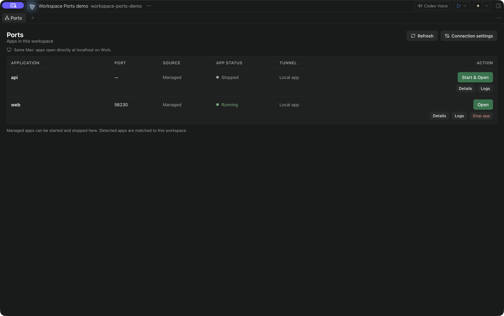

# Workspace Ports for Paseo

See workspace apps, open them in Paseo, and manage local SSH tunnels from a Ports panel. Workspace Ports supports same-Mac browsing and one configured pair of Macs running Paseo Desktop 0.14.x.



- **Managed services:** start, stop, inspect logs, and Start & Open services configured in `paseo.json`.
- **Detected listeners:** inspect and open TCP listeners associated with the workspace directory.
- **Remote apps:** review the destination and local port, then open through an SSH tunnel on your viewing Mac.
- **Separate controls:** disconnect a tunnel without stopping the remote app; reuse an existing tunnel when reopening.

## Requirements

- macOS and Paseo Desktop/daemons **0.14.x**. Other platforms and Paseo versions are not supported by this release.
- Node.js **22.13 or newer** and npm available on the installation daemon's command path. Git installation runs the manifest's locked preparation command, `npm ci --ignore-scripts`, so the builder can resolve SDK/type packages. Dependency lifecycle scripts are disabled.
- For remote apps, both hosts connected in Paseo, a running local daemon on the viewing Mac, and working noninteractive SSH key authentication with an already trusted host key.
- macOS system tools including OpenSSH, `lsof`, and `/usr/bin/trash`.

Plugins are trusted, unsandboxed code. Review [SECURITY.md](SECURITY.md) before enabling plugins on a host.

## Install

Install on the host that owns the development workspace:

```sh
paseo plugin add git:maneeshv/paseo-workspace-ports
```

This is a direct Git installation. Registry submission and approval are separate; no registry listing is claimed. The repository is intentionally marked `private: true` in `package.json` to prevent accidental npm publication.

Open **Ports** from the workspace's new-tab menu, choose **Open workspace ports** in Command Center, or use **`/ports`**. A second plugin installation on the viewing Mac is optional; its connected Paseo daemon is required for remote forwarding.

## Connect a remote workspace

Under **Connection settings**:

1. Choose the **Viewer Mac** where you are using Paseo and want the browser to open.
2. Enter an **SSH target**, such as an alias already defined in that Mac's `~/.ssh/config`, or `user@host`.
3. Choose an existing **Tunnel workspace** on the viewing Mac to hold tunnel terminals, then save.

The SSH target is a setting, not a hardcoded hostname or alias. SSH on the viewing Mac reads its own configuration to resolve the target's hostname, username, identity file, and other connection options. The plugin does not create keys, collect passwords, or accept unknown host keys.

One pairing is saved per workspace host and shared by its authorized Paseo clients. It applies across that host's workspaces; it does not automatically follow you between computers. Disconnect active tunnels before changing the pairing. For same-Mac browsing, select the workspace's own host as Viewer Mac and leave SSH target empty.

**Open** or **Start & Open** shows a confirmation with an editable local port before creating a remote tunnel. Keep the tunnel workspace active: closing the Ports panel leaves the tunnel running, while stopping its terminal or daemon ends forwarding. **Disconnect tunnel** closes only the forward. **Stop app** separately stops a configured service.

Tailscale is optional. If the configured SSH target is reachable through Tailscale, forwarding can work across networks without sharing Wi-Fi. The plugin makes no Tailscale or router changes.

The diagram uses example aliases and a Tailscale network; SSH can also use other reachable networks.

[View the architecture diagram](docs/diagrams/workspace-ports.png) · [Editable SVG](docs/diagrams/workspace-ports.svg)

## Managed and detected apps

Managed services come from the selected workspace's `paseo.json`. Use Paseo's workspace-script controls to launch development servers so service identity, assigned ports, logs, and stop controls are available. Start & Open waits for a listener before opening the app.

Detected listeners are found from TCP sockets and canonical process working directories within the workspace. This shows directory association, not proof that an agent started the process. Detected entries may include tooling; they have no process-killing controls. The plugin opens HTTP URLs, so not every discovered port will display a website.

## Limits and data access

- Automatic process discovery is macOS-only. Docker/container discovery is not included.
- Forwarding binds to `127.0.0.1` on the viewer and targets loopback on the workspace host. It does not change the remote app's own exposure or authentication.
- Existing tunnels use private SSH control sockets, separate from unrelated SSH sessions. Other local applications can still access a loopback port.
- Phone-local forwarding, public sharing, startup services, and automatic reconnection are not included. After a lost connection, disconnect the old tunnel and reopen.
- Settings contain host/workspace identifiers and the SSH target, not credentials. Process details and requested service logs are returned through Paseo to the client; browser traffic goes through the chosen SSH connection to the app. This plugin adds no analytics or model-provider calls.
- The plugin installs no software during normal activation, discovery, or tunnel creation. Git acquisition and its declared dependency preparation happen during installation.

## Development and project policies

```sh
npm ci --ignore-scripts
npm run typecheck
npm test
```

Default tests use fixtures; live integration tests require explicit opt-in. See [Contributing](CONTRIBUTING.md) and the [verification record](docs/verification.md) for coverage and remaining checks.

[MIT License](LICENSE) · [Security policy](SECURITY.md) · [Code of conduct](CODE_OF_CONDUCT.md) · [Registry submission notes](docs/submission.md)
