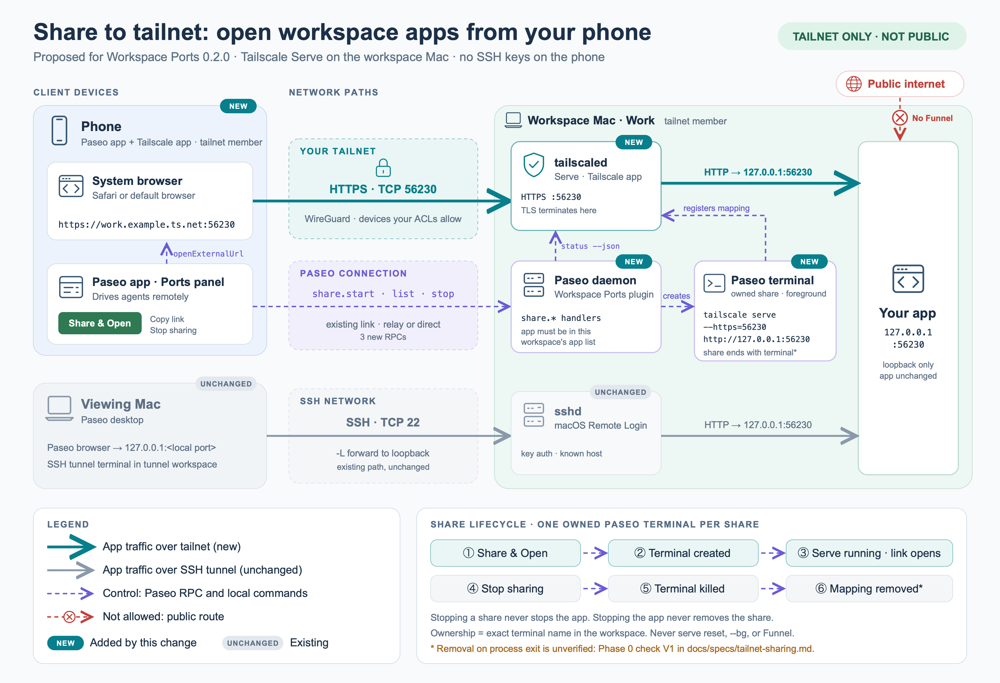
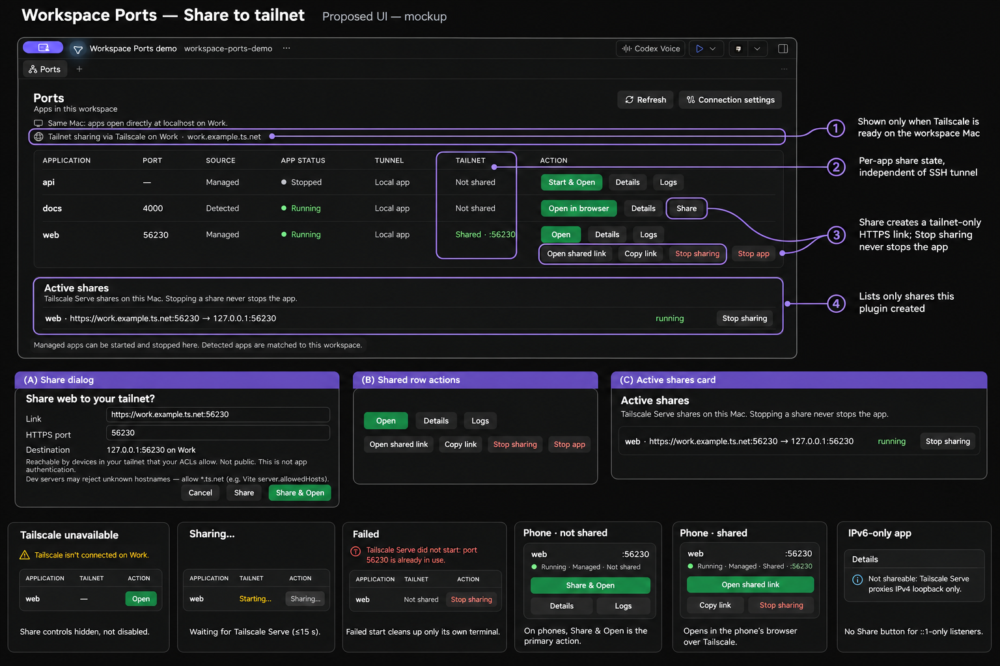

# Spec: Share workspace apps to your tailnet

Status: Implemented, pending live and phone verification (see docs/verification.md) · Target: Workspace Ports 0.2.0 · Paseo 0.14.x · macOS workspace hosts

## 1. Problem

Workspace Ports opens remote workspace apps through an SSH tunnel that runs on a *viewing Mac*. That requires SSH configuration, keys, and a trusted host key on the viewer. When a user drives Paseo from a phone, none of that exists, and Paseo does not give plugins a browser on mobile:

- `navigation.openBrowser` is documented as "Present only on Electron" (`@getpaseo/plugin/dist/client/contracts.d.ts`). On iOS/Android the panel already says opening apps requires the desktop app.
- Plugins get no HTTP proxy or route API (`PluginServerContext` offers only settings, RPC handlers, providers, usage sources, and lifecycle hooks). The phone's relay connection to the daemon cannot carry browser traffic.
- `openExternalUrl(url)` exists and opens the platform's system browser, including on mobile.

So the phone needs a URL it can reach by itself, without credentials on the device.

## 2. Solution summary

Add a second, independent way to reach an app: **Share to tailnet**. The plugin running on the **workspace host** publishes a running app with `tailscale serve`, which is HTTPS and reachable only inside the tailnet. Any device signed in to the same tailnet, such as the phone running the Tailscale app, opens `https://<host>.<tailnet>.ts.net:<httpsPort>` in its system browser.

SSH tunnels are unchanged. Sharing doesn't require Connection settings.

```
Phone (Tailscale app) ──HTTPS over tailnet──▶ tailscaled on workspace Mac ──HTTP──▶ 127.0.0.1:<appPort>
        ▲                                              ▲
        └─ openExternalUrl(url)       Paseo terminal "Paseo Ports share v1 [...]"
                                      running: tailscale serve --https=<httpsPort> http://127.0.0.1:<appPort>
```



[Editable SVG](../diagrams/tailnet-sharing.svg). Components marked NEW are added by this change; the SSH path is unchanged.

## 3. Goals

1. From any Paseo client, including phone and desktop, share a running workspace app to the tailnet with one confirmation.
2. Open the shared URL on the current device (`openExternalUrl`) and copy it.
3. Show active shares and stop them. Stopping a share never stops the app; stopping the app never removes the share.
4. Touch only shares created by this plugin. Never alter other Tailscale Serve configuration.
5. A share ends when its owning terminal ends. Nothing survives a reboot by surprise.

## 4. Non-goals

- Tailscale Funnel or any public exposure. No code path may invoke `funnel`.
- Installing Tailscale, signing in, enabling MagicDNS/HTTPS certificates, or editing tailnet ACLs.
- Persistent (`--bg`) shares, automatic re-share after reboot or reconnect.
- Apps listening only on IPv6 loopback. Serve proxies support only `http://127.0.0.1` (Tailscale docs).
- HTTPS backends, path-based mounts (`--set-path`), TCP forwarding, Docker discovery.
- Editing app configuration, for example Vite `server.allowedHosts`. The plugin explains it but doesn't change it.
- Authentication beyond tailnet membership and ACLs.

## 5. Facts this design relies on

Verified from the installed SDK (0.14.0):
- `openExternalUrl(url: string): Promise<void>`: "Open an absolute HTTP(S) URL using the client platform's external opener."
- `PluginSettings` on the server is **read/subscribe only**, and the handler context exposes only `paseo`. There is no plugin-owned server state store, which is why ownership lives in terminal names (§6.3).
- The server already creates, lists, captures, and kills terminals through `PaseoApi` (`server/apps.ts`, `client/tunnels.ts`).

Verified from Tailscale docs ([serve KB](https://tailscale.com/kb/1242/tailscale-serve), [CLI reference](https://tailscale.com/docs/reference/tailscale-cli/serve)):
- `tailscale serve --https=<port> http://127.0.0.1:<port>` is tailnet only; `funnel` is the public variant.
- `--bg` persists across reboot and `tailscale down/up`; without `--bg`, sharing must be restarted manually after a restart.
- `--yes` skips interactive prompts. `status --json` exists, but its output differs from plain `status`.
- `off` requires the original flags. `reset` clears **all** serve configuration and must never be used.
- Port proxying works on the App Store, Standalone, and open-source macOS variants.

**Phase 0 results (2026-11-04, Tailscale 1.102.2 Standalone, macOS, same-Mac client):**
- V1 ✅ The foreground mapping disappears from `serve status --json` within 3 s of SIGTERM, SIGHUP, **and SIGKILL** to the `serve` process.
- V2 ✅ Foreground mappings appear under `Foreground.<sessionId>.{TCP,Web}`. Background mappings are top-level `TCP`/`Web`. `Web` keys are `<dnsName>:<port>`, with `Handlers["/"].Proxy = "http://127.0.0.1:<port>"`.
- V3 ✅ `status --json` has `BackendState` (`"Running"`), `Self.DNSName` (with a trailing dot), `CertDomains` (equals the DNS name without the dot), and `CurrentTailnet.MagicDNSEnabled`.
- V5 ✅ An app on `*:<p>` and `serve --https=<p>` coexist. A second `serve` on an already-served port exits with `listener already exists for port <p>`, and the first share keeps working.
- V6 ✅ The backend receives `Host: <dnsName>:<httpsPort>`, `X-Forwarded-For`, and `Tailscale-User-Login`. WebSocket upgrades pass through. **The first TLS handshake on a machine took about 32 s** while the certificate was issued. Later ones took about 16 ms. The share dialog should warn that the first open may take up to a minute.
- V7 ⚠️ partial: `/Applications/Tailscale.app/Contents/MacOS/Tailscale` works for the Standalone variant (`/usr/local/bin/tailscale` is a shell wrapper around it). The App Store variant is untested. Inside Claude Code's sandbox the CLI fails with "Failed to load preferences", which does not affect the Paseo daemon.
- V8 ⓘ Terminal entries (`id`, `workspaceId`, `cwd`, `name`) have no creation time, so the wrapper prints `PASEO_PORTS_SHARE_START <epoch>` and the server measures startup age from that. Both run on the same Mac, so there's no clock skew. Because V1 holds for SIGKILL, the signal `terminal.kill()` sends no longer matters. Tab focus is not observed.
- V4, V9 ⏳ Still open: tailnet with HTTPS disabled; real phone on cellular.

**Originally unverified (kept for reference):**
- V1. Whether a foreground `serve` mapping is removed when its process exits. Check normal exit, SIGHUP/SIGTERM from a terminal kill, and SIGKILL.
- V2. Whether `serve status --json` lists foreground mappings, and its JSON shape.
- V3. Whether `tailscale status --json` contains `BackendState`, `Self.DNSName`, and `CertDomains` (HTTPS enabled).
- V4. The CLI's behavior and error text when HTTPS certificates are disabled for the tailnet.
- V5. Conflicts when the app listens on `*:<p>` and Serve uses `--https=<p>`.
- V6. The Host header the backend receives, and whether WebSocket/HMR traffic passes through Serve.
- V7. Whether `/Applications/Tailscale.app/Contents/MacOS/Tailscale` works as the CLI for the App Store and Standalone variants.
- V8. Whether Paseo creating a terminal in a workspace opens or focuses a tab, and which signal `terminal.kill()` sends.
- V9. Whether `openExternalUrl` on iOS opens Safari, and whether Safari reaches `*.ts.net` with the Tailscale VPN active.

## 6. Design

### 6.1 Placement

Everything that touches Tailscale runs in the plugin **server on the workspace host**. Clients, including phones, only call RPCs and open URLs. This is the opposite of tunnels, which run on the viewer, and it's why the phone needs no credentials.

### 6.2 Share process: a foreground serve inside a Paseo terminal

Each share is one Paseo terminal in the **app's own workspace** on the workspace host. It runs a fixed wrapper with positional arguments only, the same injection-safe pattern as `TUNNEL_SCRIPT`:

```sh
# $1 = tailscale CLI path, $2 = https port, $3 = app port
set -u
printf '\nPASEO_PORTS_SHARE_START %s\n' "$(/bin/date +%s)"
"$1" serve --yes --https="$2" "http://127.0.0.1:$3"
printf '\nPASEO_PORTS_SHARE_EXIT\n'
```

- Foreground (no `--bg`): the share's lifetime equals the terminal's lifetime. Killing the terminal stops the share. Reboots and daemon restarts don't bring it back.
- The wrapper does **not** run `serve ... off` on exit. If `serve` failed because another config already uses that port, an `off` would delete someone else's mapping. Phase 0 confirmed this isn't needed (V1), so §6.7 stays a contingency.
- The terminal is visible in the workspace, which is intentional: the user can see that something is exposed. If V8 shows it steals focus, we accept that for v1 and note it.

### 6.3 Ownership: the terminal name is the record

Name format, which round-trips like the tunnel names:

```
Paseo Ports share v1 ["<workspaceId>","<appId>",<appPort>,<httpsPort>]
```

- An owned share is a terminal in `workspaceId` whose name parses exactly and re-serializes to the same string (same rule as `listTunnels`).
- `share.stop` kills only a terminal that passes that check. Renamed, duplicate, or foreign terminals are never touched.
- Duplicate owned terminals for the same `httpsPort` produce an error asking the user to close the extras (same as `findTerminal`).

### 6.4 Share status

The server determines status locally; no heartbeat or clock comparison is needed:

| Terminal | Serve config has `httpsPort → http://127.0.0.1:<appPort>` | Status |
|---|---|---|
| present, no `PASEO_PORTS_SHARE_EXIT` | yes | `running` |
| present, no exit marker | no, < 15 s since `PASEO_PORTS_SHARE_START` | `starting` |
| present, no exit marker | no, ≥ 15 s or no start marker | `failed` (detail: last terminal lines) |
| present, exit marker | any | `failed` (detail: last terminal lines) |

The serve config comes from `serve status --json`. Mappings are collected from both the top-level config and every `Foreground` session (V2).

### 6.5 Tailscale availability (preflight)

`share.list` returns `availability`, computed on each call with a short timeout:

1. CLI path: `PASEO_PORTS_TAILSCALE_CLI` env var, else `tailscale` on `PATH`, else `/Applications/Tailscale.app/Contents/MacOS/Tailscale` if it is executable. Same approach as `scriptProcess`. Run with `execFile` only, never a shell.
2. `tailscale status --json` must show a running backend and a DNS name. HTTPS certificate support must be present (V3).
3. On failure, return `{ ok: false, reason }`, where reason is one of `not-installed`, `not-running`, `logged-out`, `https-disabled`, or `unknown`, plus a user-readable message. Never auto-fix.

### 6.6 RPC contracts (`shared/contracts.ts`)

```ts
share.list   input  { workspaceId }
             output { availability: { ok: true; dnsName: string } | { ok: false; reason: Reason; message: string },
                      shares:  { terminalId, appId, appPort, httpsPort, url, status: 'running'|'starting'|'failed', detail? }[],
                      foreign: { httpsPort, target }[] }   // serve mappings to this workspace's app ports not owned by us

share.start  input  { workspaceId, appId, httpsPort }      // httpsPort: int 1–65535
             output { share }                               // resolves once running, or throws with detail (timeout 15 s)

share.stop   input  { workspaceId, terminalId }
             output { ok: true }
```

Server-side validation for `share.start`:
- The workspace exists (`workspaceDirectory`).
- `appId` exists in a fresh `listApps(workspaceId)` result, is `running` and `listening`, has a port, and has `targetHost === '127.0.0.1'`. You can only share a port that this workspace's app list shows.
- `httpsPort` isn't already used in the serve config or by an owned share. Refuse with a clear message.
- Concurrent `share.start` calls are serialized per `httpsPort` across the whole host, because Serve ports are host-wide. A repeat call for the same workspace and app joins the in-flight start, and a call for a different app is refused with "already being shared". `share.stop` waits for any in-flight start of the same share.
- If startup fails or times out, kill only the terminal this call created (same as `startTunnel`).

### 6.7 Fallback if foreground mappings linger (V1 fails)

- Mappings left behind by a dead owned terminal can't be proven ours. They appear under `foreign` with this message: "Shared outside Workspace Ports. Remove with: `tailscale serve --https=<port> off`." The UI is read-only and offers no button.
- Revisit the design. One option is a guarded `off` in the wrapper that runs only after this process reached `running`. Make that decision with the V1 evidence, not in advance.

### 6.8 UI (`client/panel.tsx`, new `client/share.tsx`)

The new UI follows the existing panel's theme, compact/wide layouts, and wording style.



Approved design-review mockup (generated image, not a screenshot of an implementation). [Generation prompt](assets/tailnet-sharing-ui-mockup.prompt.md). Known mockup inaccuracies: the "Failed" tile's TAILNET cell should read **Failed**, not "Not shared". Callout ③ also touches the existing **Stop app** button, which is unchanged.

- **TAILNET column** (wide layout): between TUNNEL and ACTION. Values: `Not shared` (muted), `Starting…` (warning), `Shared · :<httpsPort>` (success), `Failed` (danger). Hidden when Tailscale is unavailable. In the compact layout, the same text is appended to the card's meta row.
- **Availability:** if Tailscale isn't available, show a single muted line with the reason. Share buttons are hidden, not disabled with a mystery.
- **Row actions** for a running, listening, IPv4-loopback app:
  - Not shared: a **Share** button. On phones (no `openBrowser`), it becomes the primary action, labeled **Share & Open**.
  - Shared and running: **Open shared link** (`openExternalUrl`), **Copy link**, **Stop sharing**.
  - `starting`: disabled **Sharing…**. `failed`: an error note with the detail plus **Stop sharing**, which removes the terminal.
  - IPv6-only app: Details says "Not shareable: Tailscale Serve proxies IPv4 loopback only."
- **Share dialog:**
  - Title "Share <app> to your tailnet?"
  - Fields:
    - URL preview `https://<dnsName>:<httpsPort>`
    - Editable HTTPS port, defaulting to the app port
    - Destination `127.0.0.1:<appPort> on <host>`
  - Notice text: "Reachable by devices in your tailnet that your ACLs allow. This is not app authentication. Not public."
  - Hint: "Dev servers may reject unknown hostnames; allow `*.ts.net` (for example Vite `server.allowedHosts`)."
  - Buttons: **Cancel**, **Share & Open**. On desktop, also **Share**.
- **Active shares section** (like Active tunnels): lists owned shares including orphans whose app disappeared, each with **Stop sharing**. Text: "Stopping a share never stops the app." Foreign mappings for this workspace's ports are listed read-only.
- **Stop app dialog:** add "Active shares are left in place and can be stopped separately."
- **Phone path:** when `openBrowser` is absent and Connection settings aren't configured, the "Connect this workspace to your Mac" card is replaced by a short note pointing to Share. Tunnel setup is still reachable from the header.
- Polling: `share.list` uses its own React Query key under `['paseo-ports', ...]` with a 5 s interval, so tunnel and app polling are independent.

## 7. Security requirements

- Never invoke `funnel`, `serve reset`, or `--bg`. Tests assert none of these appear in any argv.
- Use `execFile` with argv only. The wrapper gets data only through positional arguments, and every value is validated before use (ports are integers in range, IDs have no control characters, the CLI path is absolute or `tailscale`).
- Shares target only `http://127.0.0.1:<appPort>` for an app in this workspace's validated list.
- Ownership comes from the exact terminal name in the same workspace. Never stop or alter anything else.
- The share dialog and README state clearly that tailnet reach is not app authentication. ACLs decide which devices and users can connect.
- No credentials, tailnet names, or hostnames are stored. The DNS name is read live and only shown to the user.

## 8. Errors (user-facing)

| Condition | Message (approximate) |
|---|---|
| CLI missing | "Tailscale isn't installed on <host>. Install and sign in to share apps to your tailnet." |
| Not running / logged out | "Tailscale isn't connected on <host>." |
| HTTPS certificates disabled | "Enable HTTPS certificates for your tailnet in the Tailscale admin console." |
| HTTPS port in use | "Port <p> is already shared on <host>. Choose another HTTPS port." |
| App stopped/not listening | "<app> isn't listening. Start it first." |
| Startup timeout/exit | "Tailscale Serve did not start: <last terminal lines>" |
| Duplicate owned terminals | "Multiple share terminals exist for port <p>. Close the duplicates in this workspace." |

## 9. Files

| File | Change |
|---|---|
| `shared/contracts.ts` | `share.list`, `share.start`, `share.stop` RPCs; share schemas |
| `server/share.ts` (new) | CLI discovery, preflight, serve-status parsing, terminal ownership, start/stop |
| `index.server.ts` | Register the three handlers |
| `client/share.tsx` (new) | Share dialog, share row actions, Active shares section |
| `client/panel.tsx` | Wire the share query and row actions, phone-path copy, stop-dialog note |
| `tests/share.test.ts` (new) | Unit and fake-CLI lifecycle tests |
| `tests/integration.test.ts` | Opt-in real Tailscale case |
| `README.md`, `OVERVIEW.md`, `SECURITY.md`, `docs/verification.md`, `paseo-plugin.json` | Feature, requirements, data access, verification, description |

Estimated size: about 250–350 lines of source plus tests. No new dependencies.

## 10. Tests

Default (fixtures, no Tailscale needed):
- Parse `status --json` and `serve status --json` from fixture files captured during Phase 0: running, logged out, HTTPS disabled, foreground and background mappings.
- Build argv for each command. Assert no `funnel`, `reset`, or `--bg`, and that every value is a separate argument.
- Terminal names round-trip. Reject renamed, foreign-workspace, or malformed names. Error on duplicates.
- `share.start` validation: unknown app, stopped app, `::1` app, out-of-range port, port already served.
- Concurrency: concurrent starts deduplicate. Stop waits for an in-flight start. A failed start kills only the terminal it created.
- Wrapper lifecycle with a fake `tailscale` executable: records argv, stays in the foreground, and the exit marker is printed on termination.

Opt-in live (`PASEO_PORTS_TAILSCALE=1`, on top of `PASEO_PORTS_INTEGRATION=1`): uses a disposable workspace and fixture HTTP app. Share it, fetch the HTTPS URL from the same host, stop the share, and assert the mapping is gone and the app is still running. **This changes the host's Tailscale Serve config.** Document that in CONTRIBUTING and skip if the chosen HTTPS port is already in use.

Manual (record in `docs/verification.md`):
- Phone on cellular with the Tailscale app: Share & Open in Safari, Copy link, Stop sharing.
- Desktop Share plus Copy link, then open on the phone.
- A Vite app with and without `allowedHosts`.
- Compact and wide layouts in light and dark themes.

## 11. Delivery phases

0. **Spike (no plugin code):** answer V1–V9 on a real Mac and phone. Save `status --json` and `serve status --json` fixtures with private names redacted. Update §5 and §6.4/§6.7 with the findings. If V1 fails, re-review the design before Phase 1.
1. **Server:** contracts, `server/share.ts`, handlers, and unit tests.
2. **Client:** dialog, row actions, Active shares, and phone path.
3. **Verification and docs:** live test, manual phone/desktop checks, documentation updates, and a version bump to 0.2.0.

## 12. Acceptance criteria

- With Tailscale running and HTTPS enabled on the workspace Mac, a phone with only the Paseo and Tailscale apps can share a running workspace app and open it in its browser. No SSH config or keys are needed.
- Stopping a share leaves the app running. Stopping the app leaves the share visible until it's stopped.
- After the share terminal is killed, the Serve mapping is gone (V1). After a reboot, no share is active.
- The plugin never alters a Serve mapping it didn't create, and never calls Funnel, `reset`, or `--bg`.
- Without Tailscale, the panel works exactly as before, plus one explanatory line.
- `npm run typecheck` and `npm test` pass. Docs describe only verified behavior.

## 13. Open questions

1. Default HTTPS port: use the app port (current choice) or `443` for clean URLs? Only one app can use 443.
2. Should Share appear on desktop at all, or only when `openBrowser` is absent? The current choice shows it everywhere, because sharing from the desktop and then opening on the phone is useful.
3. Should archiving a workspace explicitly stop its share terminals, or is Paseo's terminal cleanup on archive enough? Check this during Phase 0.
